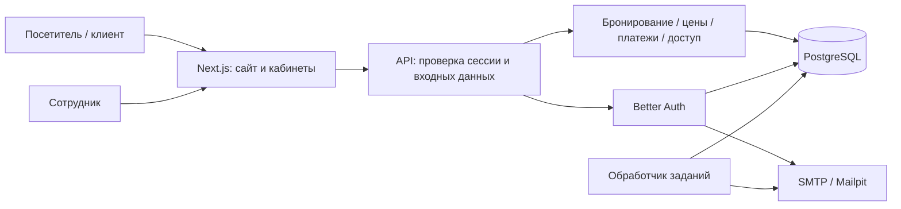

# Архитектура FRAME STUDIO

Исходное задание: [SPECIFICATION_RU.md](SPECIFICATION_RU.md). Этот документ фиксирует архитектурные решения первого рабочего этапа. Фактическое покрытие требований и выполненные проверки перечислены в [STATUS.md](STATUS.md).

## Границы первого этапа

Модульное приложение одной компании: публичный каталог, вход с подтверждением почты, серверный расчёт доступности и стоимости, бронирование, тестовый и ручной учёт платежей, кабинет клиента и рабочий список/календарь CRM. Независимые компании, платёжный эквайринг, продажа сертификатов и абонементов в этот этап не входят.

Приложение построено на Next.js App Router и TypeScript. PostgreSQL хранит авторизацию, каталог, ресурсы, заказы, денежные операции, аудит и задания. Prisma задаёт модель и миграции. Better Auth отвечает за пароли и серверные сессии. SMTP обслуживает проверку почты и восстановление доступа; для разработки используется Mailpit. MinIO в локальном окружении предусмотрен для последующего подключения приватных материалов.

## Модель предметной области

| Область | Основные сущности и правила |
| --- | --- |
| Доступ | Пользователь, серверная сессия, учётная запись, проверочный токен. Роль берётся из базы, а не из запроса клиента. |
| Студия | Настройки компании: название, город, валюта, часовой пояс, шаг, удержание, предоплата и версия правил. |
| Пространство | Физический зал отделён от локации. Локация ссылается на зал, оформление имеет период действия. |
| Ресурсы | Зал, специалист и техника представлены ограниченными ресурсами. Каждая единица ресурса резервируется на интервал. |
| Заказ | Бронирование, позиции, выделенные ресурсы, снимок оформления/цен/принятых правил. Изменения записываются в историю. |
| Расчёты | Платёж и возврат — отдельные операции. Баланс и состояние оплаты вычисляются из операций. |
| Работа | Контент-проект связан с заказом услуг специалиста; аренда сама по себе его не требует. |
| Эксплуатация | Аудит, устойчивые задания и ограничение частоты запросов. |

В демоданных пять локаций, но четыре физических зала: **Daylight и Seasonal используют один зал**. Это намеренная тестовая конфигурация для проверки общей занятости. Фактическую планировку студии необходимо настроить перед использованием.

## Доступность и атомарность

1. Сервер проверяет опубликованную локацию, оформление на дату, длительность, число участников, рабочее время и состав услуг.
2. Все нужные ресурсы блокируются в транзакции PostgreSQL в одном устойчивом порядке. Это сокращает вероятность взаимной блокировки и не позволяет двум запросам одновременно занять последнюю единицу.
3. Просроченные удержания освобождаются при работе с ресурсами. Расчёт доступности также игнорирует удержания с истёкшим сроком: задержка фонового обработчика не закрывает время навсегда.
4. На уровне базы исключающее ограничение не допускает пересечения активных резервирований одной единицы ресурса. Интервалы полуоткрытые: `[начало, конец)`.
5. Цена и выбранное оформление фиксируются вместе с заказом. Клиентский расчёт или отправленная клиентом сумма не считаются основанием для оплаты.

Подготовка и уборка расширяют интервал занятости ресурса; оплачиваемая длительность аренды хранится отдельно. Перенос выполняется одной транзакцией: новые интервалы проверяются до фиксации освобождения старых. При ошибке сохраняется исходная бронь.

Проверка свободного времени и получение расчёта **не резервируют** ресурс. Конкурирующий заказ может занять время до подтверждения. Поэтому создание и перенос всегда повторяют проверку внутри транзакции и возвращают конфликт, который интерфейс должен показать пользователю.

## Время и деньги

- Все моменты хранятся в UTC. Рабочий день, шаг и отображение рассчитываются в часовом поясе студии. Демонстрационное значение — `Asia/Almaty`; часовой пояс компьютера не является источником истины.
- Дата в форме — локальная календарная дата студии; время отправляется на сервер как ISO с явным смещением или `Z`.
- Деньги хранятся целыми числами в минимальных единицах KZT: `100` соответствует `1 ₸`. Интерфейс форматирует их, но не пересчитывает итог самостоятельно.
- Демонстрационные условия: удержание 15 минут и предоплата 30%. Это настройки продукта, а не юридические условия реальной студии.
- Округление выполняется сервером до целой минимальной единицы. Снимок позиций позволяет объяснить сумму после изменения каталога.

## Состояния заказа и оплаты

Основной путь: `awaiting_payment → confirmed → in_progress → completed`. Неоплаченное удержание заканчивается состоянием `expired`. Отмена и неявка учитываются отдельно. Разрешённые переходы проверяет доменный слой; произвольный статус из формы не записывается напрямую.

Статус оплаты независим от статуса бронирования. Источник истины — сумма поступлений минус сумма возвратов. Возврат не удаляет платёж и не может превышать полученные средства. Повтор операции с тем же ключом идемпотентности не создаёт ещё одно поступление.

Тестовая оплата доступна только в явно включённом тестовом режиме. Ручная операция требует роли сотрудника и сохраняет сотрудника, сумму, время и комментарий. Реальный платёжный провайдер потребует отдельного адаптера с серверным созданием платежей, проверкой подписей, валюты и суммы уведомления, идемпотентностью и сверкой статуса. Переход браузера на страницу успеха не подтверждает платёж.

Для позднего поступления сервер повторно проверяет ресурсы. Если они уже заняты, новая подтверждённая бронь не создаётся; операция требует решения сотрудника и возврата либо согласования другого времени.

## Границы доступа

| Роль | Видимость и действия |
| --- | --- |
| Посетитель | Опубликованный каталог, доступность и предварительный расчёт. |
| `CLIENT` | Собственные бронирования и разрешённые клиентские действия. |
| `SPECIALIST` | Назначенные этому специалисту бронирования. |
| `ADMIN` | Работа с расписанием и заказами, ручными платежами и разрешёнными переходами. |
| `OWNER` | Доступ администратора и управление конфигурацией через предусмотренные административные средства. |

Доступ проверяется на сервере и на уровне конкретного объекта. Знание номера или идентификатора заказа не даёт права его читать. Регистрация не позволяет назначить себе роль сотрудника. Номер телефона — контакт в заказе, а не средство входа.

## Контракт API первого этапа

| Маршрут | Назначение |
| --- | --- |
| `GET /api/catalog` | Публичные локации, услуги, специалисты, техника и безопасная часть настроек. |
| `GET /api/availability` | Свободные интервалы по дате, длительности и выбранным ресурсам. |
| `POST /api/quote` | Серверная разбивка цены и предоплаты без резервирования. |
| `GET /api/session` | Текущий пользователь и роль. |
| `/api/auth/*` | Регистрация, подтверждение почты, вход, восстановление и сессии Better Auth. |
| `POST /api/bookings` | Создание удержания для авторизованного клиента. |
| `GET /api/bookings` | Собственные или разрешённые ролью заказы. |
| `GET /api/bookings/:id` | Подробности заказа с проверкой доступа. |
| `POST /api/bookings/:id/actions` | Оплата, возврат, перенос, отмена и переход состояния с проверкой роли. |
| `GET /api/health` | Проверка работоспособности приложения и базы. |

Запросы, изменяющие данные, проходят проверку источника запроса и серверную валидацию. Ошибки передаются как `{ "error": "понятное описание" }`, без секретов и внутренних трассировок.

## Допущения и следующие этапы

Первый этап использует простые почасовые тарифы, фиксированные дополнения и одну компанию. Полный редактор контента, пакеты и промокоды, CRM-воронка, управление сотрудниками/закрытиями, защищённая передача больших файлов, расширенная аналитика и полный набор автоматических уведомлений развиваются отдельно. Сертификаты, абонементы, лист ожидания, реферальные предложения и внешние календари относятся ко второму этапу исходного задания.

Демоиллюстрации, названия специалистов и цены служат тестовыми данными. Реальные контакты, отзывы, оплаты и показатели бизнеса в начальный набор не добавляются. Юридические страницы требуют проверки и утверждения владельцем до публичного запуска.
